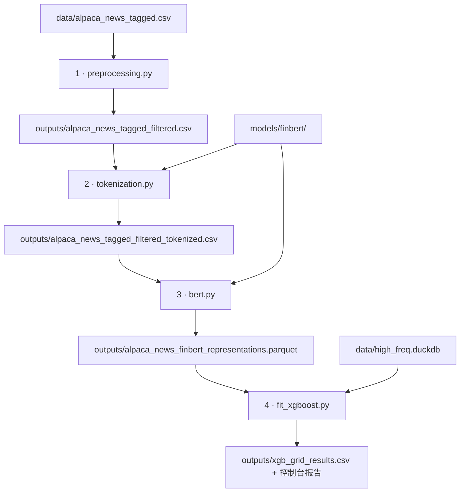

# Quant_NLP

**English** | [中文](#中文)

Predicts whether a US stock ends the trading day above the price you could have bought it at after a news article, using FinBERT text representations and XGBoost.

- [Introduction](#introduction)
- [Pipeline](#pipeline)
- [Data you need](#data-you-need)
- [Configuration](#configuration)
- [Usage](#usage)
- [Notes](#notes)

## Introduction

Quant_NLP is a four-step research pipeline that turns financial news into a same-day direction signal:

1. **Clean** tagged Alpaca news articles that mention exactly one ticker.
2. **Tokenize** the cleaned text with the FinBERT tokenizer.
3. **Encode** every article with FinBERT ([ProsusAI/finbert](https://huggingface.co/ProsusAI/finbert)). This gives five 768-d sentence representations plus the raw 3-way sentiment logits.
4. **Label and model.** Each article is labeled with the stock's return from the first tradable minute after publication to that trading day's close, using 1-minute bars stored in DuckDB. One XGBoost classifier is fitted per representation. The report shows how often a predicted "up" really went up, compared with the test set's base rate.

## Pipeline


Each step reads only the previous step's output. To re-run a later step with different settings, you don't need to start from step 1.

### Step 1: `preprocessing.py` (filter and clean)

- Keeps rows with `tag == 1` and drops rows whose `symbols` lists more than one ticker.
- Cleans `headline`, `summary` and `content` with the same chain of steps:
  - decode `&amp;`, and remove other HTML entities, `<tags>`, CSS rule blocks, URLs and e-mail addresses;
  - convert curly quotes, dashes and ellipses to ASCII;
  - apply NFKD normalization, then drop any remaining non-ASCII characters;
  - replace every character outside `[A-Za-z0-9 .,!?;:'"()%$&/+-]` with a space, then collapse whitespace.
- Adds `headline_filtered`, `summary_filtered`, `content_filtered` and `body_filtered` (cleaned headline + cleaned content), plus the raw `body`.

### Step 2: `tokenization.py` (tokenize)

- Encodes the text column named by `CONTENT_COLUMNS` with the local FinBERT tokenizer. The default is `summary_filtered`; change it to `body_filtered` or `headline_filtered` to model other text.
- Adds `[CLS]`/`[SEP]`, truncates to 512 tokens and pads every row to exactly 512.
- Writes `<CONTENT_COLUMNS>_tokens`, `<CONTENT_COLUMNS>_mask`, `symbols` and `created_at`.

### Step 3: `bert.py` (FinBERT representations)

Runs FinBERT once per article and stores these columns in one parquet file:

| Column | Dim | Meaning |
|---|---|---|
| `cls_last` | 768 | `[CLS]` vector of the last encoder layer (layer 12) |
| `pooler` | 768 | `tanh(W · cls_last + b)`, the fine-tuned pooling head |
| `mean_last` | 768 | mean of the last layer over non-`[PAD]` tokens |
| `cls_second_last` | 768 | `[CLS]` vector of layer 11 |
| `mean_second_last` | 768 | masked mean of layer 11 |
| `logits` | 3 | raw (pre-softmax) scores of the sentiment head |

- The order of the `logits` columns is read from the checkpoint. For ProsusAI/finbert it is **positive, negative, neutral**. The order is saved in the parquet schema metadata under `logit_labels`.
- Speed: inside each chunk, rows are sorted by their true length and batched by a token budget (`TOKENS_PER_BATCH`). Each batch is trimmed to its longest row. This needs about 4.7× less compute than running every row at 512 tokens.
- Rows missing the ticker, timestamp, ids or mask are dropped. To match the output to earlier files, join on `symbols` + `created_at`, not on row position.
- For a quick test run, set `LIMIT_ROWS = 2_000`.

### Step 4: `fit_xgboost.py` (labels, split, model)

**Labels**
- Each article is assigned to trading day **T**: the first trading day whose regular session closes strictly after the publish time. News from weekends, holidays and after hours therefore rolls to the next session.
- **Entry** is the open of T's first regular-session bar that starts at or after the publish time. For pre-market news, that is T's open.
- **Exit** is the close of T's last regular-session bar. The regular session is 09:30–16:00 New York time, or 09:30–13:00 on the half days listed in `EARLY_CLOSE_DAYS`.
- `target_return = exit / entry − 1`, and `label = 1` if `target_return > 0`, else `0`.
- Articles that share one trade (same ticker, trade date and entry time) are collapsed to a single row. `KEEP_PER_ENTRY` picks which one.

**Split.** The split is chronological and aligned to date boundaries: the first 70% of rows are train and the last 30% are test. The last 20% of train is the validation set, used for early stopping and grid selection. The test set is never used for tuning.

**Model.** For each entry in `REPRESENTATIONS`, every combination in `PARAM_GRID` is fitted with early stopping on validation logloss. By default the grid is `learning_rate × max_depth × subsample`, 48 combinations. The best combination is refitted on the whole training set, using its early-stopped number of trees, and scored on the test set.

**Report.** For each representation, the console shows:
- `precision_up`: the share of predicted ups that really went up, next to the test set's base rate of ups;
- `n_pred_up`, `pred_up_rate` and `accuracy`.

Every grid combination is written to `xgb_grid_results.csv`.

## Data you need

The three inputs (FinBERT model, minute-bar database and tagged news) can be downloaded from Google Drive:

> 📦 **Download:** [Google Drive](https://drive.google.com/drive/folders/1X4NKb29yGoH6cwxr8hvRlGRYPH0HHEhv?usp=sharing)

After downloading, put them in the default locations below, or point `config.py` at wherever you saved them.

| Input | Default location | Format |
|---|---|---|
| Tagged news | `data/alpaca_news_tagged.csv` | CSV with columns `id, headline, summary, content, symbols, created_at, tag`. `symbols` holds comma-separated tickers, `created_at` is an ISO-8601 UTC time, `tag` is 1 = keep, 0 = drop. |
| Minute bars | `data/high_freq.duckdb` | DuckDB file with **one table per trading day**, named `YYYY-MM-DD`. Columns: `ticker`, `window_start` (bar start, UTC epoch **nanoseconds**), `open`, `close`. The table names serve as the trading calendar. |
| FinBERT | `models/finbert/` | Hugging Face model directory (`config.json`, `model.safetensors` or `pytorch_model.bin`, `vocab.txt`, tokenizer files) of a `BertForSequenceClassification` checkpoint. It is loaded offline (`local_files_only=True`). |

## Configuration

**All paths are set in [`config.py`](config.py).** Every script reads from it, so a path changed there applies to all four steps:

| Variable | Default | Used by |
|---|---|---|
| `NEWS_TAGGED_CSV` | `data/alpaca_news_tagged.csv` | step 1 input |
| `PRICES_DB` | `data/high_freq.duckdb` | step 4 input |
| `MODEL_DIR` | `models/finbert` | steps 2 and 3 |
| `OUTPUT_DIR` | `outputs` | parent folder of the four files below |
| `NEWS_FILTERED_CSV` | `outputs/alpaca_news_tagged_filtered.csv` | step 1 → step 2 |
| `NEWS_TOKENIZED_CSV` | `outputs/alpaca_news_tagged_filtered_tokenized.csv` | step 2 → step 3 |
| `FINBERT_PARQUET` | `outputs/alpaca_news_finbert_representations.parquet` | step 3 → step 4 |
| `XGB_GRID_RESULTS_CSV` | `outputs/xgb_grid_results.csv` | step 4 output |
| `DEVICE` | `'auto'` | step 3: `'auto'` tries CUDA, then Apple MPS, then CPU; or set `'cuda'` / `'mps'` / `'cpu'` |

Relative defaults are resolved against the repository folder. To keep your data elsewhere, use absolute paths, and keep them as `Path` objects:

```python
# config.py
PRICES_DB = Path('/mnt/quant_db/high_freq.duckdb')
MODEL_DIR = Path.home() / 'models' / 'finbert'
```

Settings for each step are at the top of its script:

| Script | Settings |
|---|---|
| `tokenization.py` | `CONTENT_COLUMNS`: which cleaned text column to encode |
| `bert.py` | `CHUNK_ROWS`, `TOKENS_PER_BATCH`, `MAX_BATCH_ROWS`: memory and speed; `LIMIT_ROWS`: test-run size |
| `fit_xgboost.py` | `REPRESENTATIONS`, `PARAM_GRID`, `FIXED_PARAMS`, `TEST_SIZE`, `VALID_SIZE`, `KEEP_PER_ENTRY`, `EARLY_CLOSE_DAYS`, session times |

## Usage

**1. Install** (Python 3.11+):

```bash
git clone https://github.com/GavinLiu222/Quant_NLP.git
cd Quant_NLP
python -m venv .venv && source .venv/bin/activate
pip install -r requirements.txt
```

For a GPU, first install the PyTorch build that matches your CUDA version (see [pytorch.org](https://pytorch.org/get-started/locally/)).

**2. Download the data** from [Google Drive](https://drive.google.com/drive/folders/1X4NKb29yGoH6cwxr8hvRlGRYPH0HHEhv?usp=sharing) (see [Data you need](#data-you-need)) and put it in the default layout, or wherever `config.py` points:

```
Quant_NLP/
├── config.py               ← paths and device
├── preprocessing.py        ← step 1
├── tokenization.py         ← step 2
├── bert.py                 ← step 3
├── fit_xgboost.py          ← step 4
├── requirements.txt
├── data/
│   ├── alpaca_news_tagged.csv
│   └── high_freq.duckdb
├── models/
│   └── finbert/            ← config.json, model weights, vocab.txt, ...
└── outputs/                ← created by the scripts
```

**3. Run the four steps in order:**

```bash
python preprocessing.py    # 1. filter + clean
python tokenization.py     # 2. tokenize
python bert.py             # 3. FinBERT representations
python fit_xgboost.py      # 4. labels + XGBoost + report
```

All paths come from `config.py`, so you can run the scripts from any working directory. Output folders are created as needed.

## Notes

- The scripts are written for **pandas ≥ 3.0**, whose default string dtype step 1 relies on.
- When the price database gets new data, add the new NYSE half days to `EARLY_CLOSE_DAYS` in `fit_xgboost.py`.
- `data/`, `models/` and `outputs/` are in `.gitignore`, so large files are never committed.
- This is research code, not investment advice.

## License

[MIT](LICENSE)

---

<a id="中文"></a>

# Quant_NLP（中文）

[English](#quant_nlp) | **中文**

利用 FinBERT 文本表征和 XGBoost，预测美股在一条新闻发布后、从可买入价格到当日收盘是否上涨。

- [项目介绍](#项目介绍)
- [Pipeline 说明](#pipeline-说明)
- [所需数据](#所需数据)
- [配置](#配置)
- [使用方法](#使用方法)
- [注意事项](#注意事项)

## 项目介绍

Quant_NLP 是一个四步研究流程，把财经新闻转化为“当日涨跌方向”信号：

1. **清洗**：保留已打标签、且只提及一只股票的 Alpaca 新闻，并清洗文本。
2. **分词**：用 FinBERT 的 tokenizer 对清洗后的文本编码。
3. **编码**：用 FinBERT（[ProsusAI/finbert](https://huggingface.co/ProsusAI/finbert)）为每篇新闻提取 5 种 768 维句向量，以及 3 分类情绪头的原始 logits。
4. **打标签并建模**：基于 DuckDB 中的 1 分钟 K 线，为每篇新闻计算“发布后第一个可交易分钟 → 当日收盘”的收益并打标签。然后对每种表征各训练一个 XGBoost 分类器，并报告“预测上涨”中实际上涨的比例，与测试集的上涨基准率对比。

## Pipeline 说明



每一步只读取上一步的输出。修改某一步的参数后，只需从这一步重新运行，不必从第 1 步开始。

### 第 1 步：`preprocessing.py`（过滤与清洗）

- 保留 `tag == 1` 的行，删除 `symbols` 中包含多只股票的行。
- 对 `headline`、`summary`、`content` 执行相同的清洗步骤：
  - 还原 `&amp;`，去掉其他 HTML 实体、`<标签>`、CSS 规则块、URL 和邮箱地址；
  - 将弯引号、破折号、省略号转为 ASCII；
  - 做 NFKD 规范化，然后删除剩余的非 ASCII 字符；
  - 把 `[A-Za-z0-9 .,!?;:'"()%$&/+-]` 以外的字符替换为空格，再合并连续空白。
- 新增 `headline_filtered`、`summary_filtered`、`content_filtered`、`body_filtered`（清洗后的标题 + 正文），以及未清洗的 `body`。

### 第 2 步：`tokenization.py`（分词）

- 用本地 FinBERT tokenizer 编码 `CONTENT_COLUMNS` 指定的文本列。默认是 `summary_filtered`，可改为 `body_filtered` 或 `headline_filtered` 来使用其他文本。
- 添加 `[CLS]`/`[SEP]`，超过 512 个 token 的截断，每行都补齐到 512。
- 输出 `<CONTENT_COLUMNS>_tokens`、`<CONTENT_COLUMNS>_mask`、`symbols`、`created_at`。

### 第 3 步：`bert.py`（FinBERT 表征）

每篇新闻只过一次 FinBERT，以下各列写入同一个 parquet 文件：

| 列名 | 维度 | 含义 |
|---|---|---|
| `cls_last` | 768 | 最后一层（第 12 层）的 `[CLS]` 向量 |
| `pooler` | 768 | `tanh(W · cls_last + b)`，即微调过的 pooler 输出 |
| `mean_last` | 768 | 最后一层在非 `[PAD]` token 上的平均 |
| `cls_second_last` | 768 | 第 11 层的 `[CLS]` 向量 |
| `mean_second_last` | 768 | 第 11 层的 masked 平均 |
| `logits` | 3 | 情绪分类头未经 softmax 的原始分数 |

- `logits` 各列的顺序从模型配置中读取。ProsusAI/finbert 的顺序是**positive、negative、neutral**，并写入 parquet schema 元数据的 `logit_labels` 字段。
- 加速：每个 chunk 内按真实长度排序，按 token 预算（`TOKENS_PER_BATCH`）组 batch，并把每个 batch 截到其中最长的那一行。这比每行都按 512 个 token 计算约少 4.7 倍。
- 缺少股票代码、时间、ids 或 mask 的行会被丢弃。与之前的文件对齐时，请用 `symbols` + `created_at` 关联，不要按行号对齐。
- 想快速试跑，可设 `LIMIT_ROWS = 2_000`。

### 第 4 步：`fit_xgboost.py`（标签、划分、建模）

**标签**
- 每篇新闻归属交易日 **T**：常规交易时段收盘时间严格晚于发布时间的第一个交易日。因此周末、节假日和盘后的新闻会顺延到下一个交易日。
- **入场价**：T 日常规时段中，起始时间 ≥ 发布时间的第一根 K 线的开盘价。盘前新闻即为 T 日开盘价。
- **出场价**：T 日常规时段最后一根 K 线的收盘价。常规时段为纽约时间 09:30–16:00，`EARLY_CLOSE_DAYS` 中的半日市为 09:30–13:00。
- `target_return = 出场价 / 入场价 − 1`；`target_return > 0` 时 `label = 1`，否则为 `0`。
- 对应同一笔交易（同一股票、同一交易日、同一入场时间）的多篇新闻只保留一条，由 `KEEP_PER_ENTRY` 决定保留哪条。

**数据划分**：按时间顺序划分，切分点对齐到日期边界。前 70% 为训练集，后 30% 为测试集；训练集的最后 20% 作为验证集，用于早停和网格选参。测试集从不参与调参。

**模型**：对 `REPRESENTATIONS` 中的每种表征，遍历 `PARAM_GRID` 的所有组合，以验证集 logloss 早停。默认网格是 `learning_rate × max_depth × subsample`，共 48 组。最优组合用早停得到的树数，在完整训练集上重新训练，再在测试集上评估。

**报告**：每种表征在控制台输出：
- `precision_up`：预测上涨中实际上涨的比例，并与测试集的上涨基准率对比；
- `n_pred_up`、`pred_up_rate`、`accuracy`。

每组网格参数的结果写入 `xgb_grid_results.csv`。

## 所需数据

三份输入（FinBERT 模型、分钟 K 线数据库、标签新闻）可从 Google Drive 下载：

> 📦 **下载：** [Google Drive](https://drive.google.com/drive/folders/1X4NKb29yGoH6cwxr8hvRlGRYPH0HHEhv?usp=sharing)

下载后放到下表的默认位置，或在 `config.py` 中改成实际保存的路径。

| 输入 | 默认位置 | 格式 |
|---|---|---|
| 标签新闻 | `data/alpaca_news_tagged.csv` | CSV，列为 `id, headline, summary, content, symbols, created_at, tag`。`symbols` 为逗号分隔的股票代码，`created_at` 为 ISO-8601 UTC 时间，`tag` 中 1 = 保留、0 = 丢弃。 |
| 分钟 K 线 | `data/high_freq.duckdb` | DuckDB 文件，**每个交易日一张表**，表名为 `YYYY-MM-DD`。列：`ticker`、`window_start`（K 线起始时间，UTC **纳秒**时间戳）、`open`、`close`。表名即交易日历。 |
| FinBERT | `models/finbert/` | Hugging Face 格式的模型目录（`config.json`、`model.safetensors` 或 `pytorch_model.bin`、`vocab.txt`、tokenizer 文件），是 `BertForSequenceClassification` 权重。离线加载（`local_files_only=True`）。 |

## 配置

**所有路径都在 [`config.py`](config.py) 中设置。** 每个脚本都从这里读取，因此在这里改一个路径，四个步骤都会生效：

| 变量 | 默认值 | 用途 |
|---|---|---|
| `NEWS_TAGGED_CSV` | `data/alpaca_news_tagged.csv` | 第 1 步输入 |
| `PRICES_DB` | `data/high_freq.duckdb` | 第 4 步输入 |
| `MODEL_DIR` | `models/finbert` | 第 2、3 步 |
| `OUTPUT_DIR` | `outputs` | 下面四个文件所在的文件夹 |
| `NEWS_FILTERED_CSV` | `outputs/alpaca_news_tagged_filtered.csv` | 第 1 步 → 第 2 步 |
| `NEWS_TOKENIZED_CSV` | `outputs/alpaca_news_tagged_filtered_tokenized.csv` | 第 2 步 → 第 3 步 |
| `FINBERT_PARQUET` | `outputs/alpaca_news_finbert_representations.parquet` | 第 3 步 → 第 4 步 |
| `XGB_GRID_RESULTS_CSV` | `outputs/xgb_grid_results.csv` | 第 4 步输出 |
| `DEVICE` | `'auto'` | 第 3 步：`'auto'` 依次尝试 CUDA、Apple MPS、CPU；也可指定 `'cuda'` / `'mps'` / `'cpu'` |

相对路径默认以仓库目录为根。数据放在其他位置时，请写绝对路径，并保持 `Path` 类型：

```python
# config.py
PRICES_DB = Path('/mnt/quant_db/high_freq.duckdb')
MODEL_DIR = Path.home() / 'models' / 'finbert'
```

各步骤自己的参数在对应脚本开头：

| 脚本 | 参数 |
|---|---|
| `tokenization.py` | `CONTENT_COLUMNS`：编码哪一列清洗后的文本 |
| `bert.py` | `CHUNK_ROWS`、`TOKENS_PER_BATCH`、`MAX_BATCH_ROWS`：内存与速度；`LIMIT_ROWS`：试跑行数 |
| `fit_xgboost.py` | `REPRESENTATIONS`、`PARAM_GRID`、`FIXED_PARAMS`、`TEST_SIZE`、`VALID_SIZE`、`KEEP_PER_ENTRY`、`EARLY_CLOSE_DAYS`、交易时段 |

## 使用方法

**1. 安装**（Python 3.11+）：

```bash
git clone https://github.com/GavinLiu222/Quant_NLP.git
cd Quant_NLP
python -m venv .venv && source .venv/bin/activate
pip install -r requirements.txt
```

如需使用 GPU，请先按 [pytorch.org](https://pytorch.org/get-started/locally/) 安装与 CUDA 版本对应的 PyTorch。

**2. 下载数据**：从 [Google Drive](https://drive.google.com/drive/folders/1X4NKb29yGoH6cwxr8hvRlGRYPH0HHEhv?usp=sharing) 下载（见[所需数据](#所需数据)），按默认目录结构放置，或放在 `config.py` 指向的位置：

```
Quant_NLP/
├── config.py               ← 路径与设备
├── preprocessing.py        ← 第 1 步
├── tokenization.py         ← 第 2 步
├── bert.py                 ← 第 3 步
├── fit_xgboost.py          ← 第 4 步
├── requirements.txt
├── data/
│   ├── alpaca_news_tagged.csv
│   └── high_freq.duckdb
├── models/
│   └── finbert/            ← config.json、模型权重、vocab.txt 等
└── outputs/                ← 脚本自动创建
```

**3. 按顺序运行四个步骤：**

```bash
python preprocessing.py    # 1. 过滤 + 清洗
python tokenization.py     # 2. 分词
python bert.py             # 3. FinBERT 表征
python fit_xgboost.py      # 4. 标签 + XGBoost + 报告
```

所有路径都来自 `config.py`，因此可以在任意工作目录下运行脚本。输出文件夹会在需要时自动创建。

## 注意事项

- 脚本基于 **pandas ≥ 3.0** 编写，第 1 步依赖其默认的字符串类型。
- 价格数据库加入新数据后，请把新的纽交所半日市日期加入 `fit_xgboost.py` 的 `EARLY_CLOSE_DAYS`。
- `data/`、`models/`、`outputs/` 已加入 `.gitignore`，大文件不会被提交。
- 本项目为研究代码，不构成投资建议。

## 许可证

[MIT](LICENSE)
